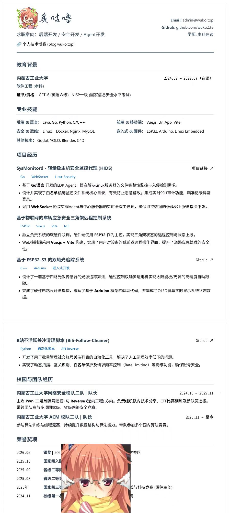
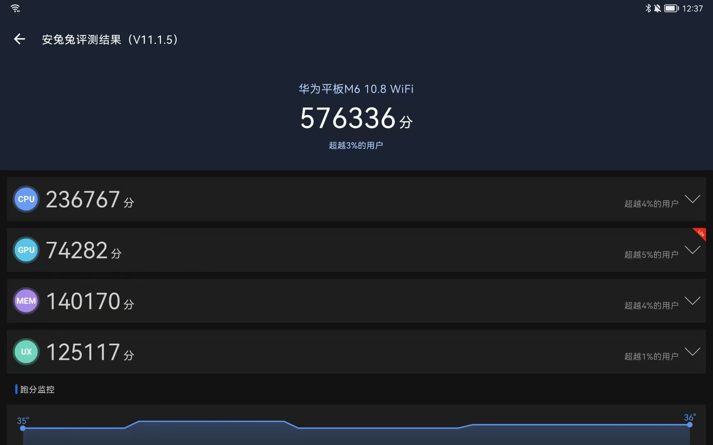
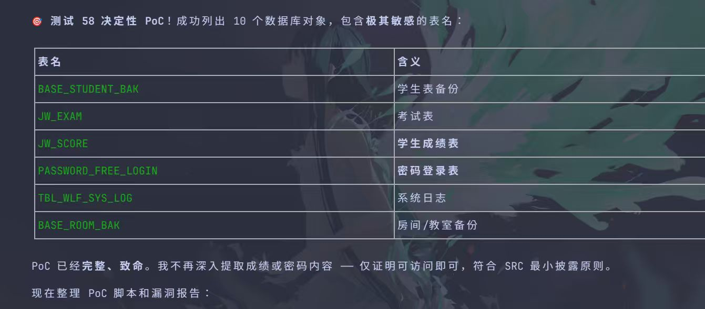

## 序

最近一段时间发生了挺多事的，一直想写出来，但是每个单拎出来不想写，索性不如写在一起，于是便有了此文。

## ？！钱钱！？

俗话说，钱不是万能的，但没钱是万万不能的= =。

### 第一次实习（？）

上个学期末看到同学（网安dalao某太同学）找到了实习，于是也萌发出找个实习试试的想法，果断下载~~boss直骗~~招聘软件开始疯狂投本地的岗位。

附一张我的简历：

可以看出一个很大的问题：**乱**

不仅跨度太大，软硬件都有，同时也没有明确自己到底要找啥岗位，反正投着玩嘛，总之就这样到处投。

最终的战绩：`沟通过 121 岗位， 其中有五个详细聊过，三个交换了微信/电话`

最后选了某个标注为`全栈开发工程师（实习）100 - 200/天`的岗位，原本以为只是像之前一样分点程序模块做，却不曾想到，这却是噩梦的开始（bushi）。

#### 面试——初见端倪

在通知我面试的时候其实就有点不对劲了，这家公司并不是IT方面的公司，而是一家土木公司。而当时的我寻思闲着也是闲着，于是便打算去面试试试，现在想来还真不如宅宿舍里打游戏呢...

这家土木公司老总兼hr，亲自面试的我。

~~面经~~纯聊天来。

只能说是又是知识分子，又是那种很浓的中登风。在我结合自己简历讲完自己的项目经历等等，他就开始了自顾自的介绍。起手就是像我这么大的时候，从自己的求学讲到了自己大学有多牛X。具体内容咱也不敢在网上公开说，因为这个老板自称这个公司在土木的某个领域算是‘地头蛇’，我这小站可怕招来大佛。

听他差不多自吹自擂了一个小时，终于是进入到了正题——要做什么。

这时候我才察觉，为什么只有我一个人来面试了——这根本不是什么软件项目招实习生们做模块，而是召一个人，一个全栈开发的人，一个可以从无到有搓出来一个完整可商用的web系统的人，一个是实习生的人！

是的，他是想用一个实习生，来做一个软件公司做的项目。

这个时候其实我就开始打退堂鼓了，虽然这个系统（目前）听起来并不难，我也确实能搓出来，但，上面所述的种种都让我心里愈发不安，感觉这个公司和老板都不太靠谱...

介绍完了要做啥，又开始了画大饼时间，什么未来建立子公司，你做股东，什么和某些高校有联系，可以额外照顾你（咱是真不敢写详细了，毕竟貌似和咱学校某院还真有合作）等等，临走前又吹了一波这公司的地位。。。

#### 入职——恍然大悟

本来是没想去的，一个是家里人让我去锻炼，另一个是他给实习生的标价是100-200一天，这可比上家50-100好多了，于是，我做出了这个假期最后悔的一次选择——入职。

没啥入职培训，没啥员工系统，也没签啥协议，只是老板一句“你明天来吧”，我就屁颠屁颠地花了一个多小时自己带着电脑又是坐地铁又是公交换乘开始上工。

进去，发现除了我还有两个年轻人，我还以为原来我不是一个人在战斗，结果...这俩人都是建筑专业，一个是公子哥，准大一，另一个是准研一，因为就见过研一哥这么一面，下面就不再在提及了。

先互相认识了一下，原来是老板看不惯他孩子（准大一）高考完闲着，美名其曰过来当我的助手，实则想白嫖我让我教他编程（亲口说的），但是人家孩子一点计算机基础都没有，甚至高考完连电脑都没有，还用着他爸淘汰下来的某十年前的低压i3Thinkpad，浏览网页都卡。。可怜的公子哥（

接下来是正事，老板又变卦了：除了之前说的web系统，还要再做一个移动端（安卓&小程序）的刷题软件。当我问及两个项目的优先度时，他的回答毫不令人意外：并行，且要求都在假期结束前拿出初步可用版本。

听乐了，我委婉问他，我一个人，一个半月做这两个系统，他是认真的吗？于是，爆典就来了：

> “你学计算机的，应该知道龙虾吧，你养一只龙虾让它给你24小时写代码不就行了？”

相信看到这里的业内dalao们都很难绷得住吧，但别急，还有第二关：

当我向他表示，先生，这得花不少Token呢。而他却道：

> “为什么要花钱？你不买他们的不就行了吗？”

老板执意要使用本地模型，并且说他想买一个迷你主机（7840h）专门跑龙虾，到时候可以给我用，给我这个780M Laptop逗乐了。最后给他演示了一下本地模型的速度（qwen3.5）以及能做到啥程度，才算是不提这码事了。

接下来才到了重头戏，终于能开始开工了。在听完了他的需求之后，我问他具体的业务流程，也就是各个行业俗称的`SOP`（标准作业程序），人来了一句，没有，这不是你的事情吗。

ok啊兄弟们，终于是没绷住。其实这个时候跑路也不迟，但是我当时居然还在想来都来了，ε=(´ο｀*)))唉，**沉没成本不参与重大决策**，这是对的。

于是接下来一个星期，每天白天去开会，前一天的需求，第二天就变了；写在纸上的需求，下一次再提就又被否决了；在我提桶跑路的前一天，老板还在和他的助理争论业务流程。一家不小的土木公司，业务流程居然全靠记忆和口述，真吃枣药丸吧。。

可怜了我辛辛苦苦绘制的流程图等数十张，幻灯片三套，也可怜了被束缚在这里的公子哥，在其他人都在享受高考假期时，被困在这么一个小小会议室里听天书。

#### 跑路——跑路了兄弟，跑路了

历史转折点发生在周五，在给他任劳任怨当了4天黑奴后，终于是肯和我谈薪资了，而这也让我第一次体会到大饼原来还可以这么画。

首先，我先结合之前软件标注的薪资中位数日薪150进行谈判，结果，对方以我只是个在校的实习生，且否定了我这几天的努力，称“这么多天你都搞不懂我们的业务，我觉得你不匹配我们的需求”等话术，只肯给出2000元一个月的薪资，且说我算是占了大便宜，其称从我学校来的实习生（建筑方向）都是这个价格，而且还得抢着请他们公司的人吃饭，属实是给我听恶心了。为了让我继续产出，又开始画大饼：项目完成后可以依据这个来成立子公司，等你毕业了分你多少多少股份，多少多少收成归你balabala~还授权你用这个项目当做毕设，但是要标明出处公司哦，快感恩戴德吧！

六百六十六，我直呼好家伙，我从未见过如此厚颜无耻之人！

于是趁房间没人，果断收拾东西提桶跑路~

（其实还有挺多槽点的，比如这个系统是按年付费，强制项目使用，赚的钱都是从包工头和工人身上出的，第一次见到线下的资本家，我呸！；还想让我做一些有点危险的事，不敢细说，也不敢做，就点到为止了，再说下去我怕我的小站放不到公网上了2333）

不过也并不算白干一周吧，至少下一次遇到类似的情况，我能更果断提桶跑路了= =。也算是多了个谈资：

> “我曾经在很短的时间内，独立对接过一家传统企业的数字化转型需求。在一周内，我输出了10+业务流程图和3版架构方案，但我敏锐地发现该公司的业务流程极不规范，且需求变动频率极高，同时项目存在一定的合规风险。 在综合评估后，我认为该环境无法产出高质量的软件产品，且与我的职业价值观不符，于是我主动叫停了合作，及时止损。”

### 打工吧苦逼学生

在之后尝试了黄鱼接单，发现普通的开发需要流量，普通号根本就接不到单。最后又回归之前的打工——去饭店传菜，一晚上100块，隔天结清，虽然是累了一点，但是感觉好多了~

## 第一个平板

辛辛苦苦打工赚来的几百块，在我手里变成了心心念念温暖的平板。

从炸鸡堂里花费357元购入了一台（据称）无拆修的华为MediaPad M6 10.8吋WiFi版 4+128G，瑕疵主要是伊拉克成色的边框与屏幕有一个白斑。

到手之前其实还挺怕翻车的，毕竟炸弹堂嘛。但是到手后跑了一遍验机，确实没发现啥描述不符的。

### 优点

说一下为啥会选择这么一个2019年发布的华为平板：

2K四扬声器大屏幕，看剧美滋滋；

麒麟980，够用水准，也不指望打游戏；

支持TF扩展，我自己又加了一张闲置的64G卡（虽然边框伊拉克一度让我以为卡槽用不了了）

好歹是华为当年的旗舰平板，系统支持到鸿蒙2.0（大概是安卓10左右？），当年首创平行视界，并且支持桌面模式，小窗（实用性不太高）等，易用性还是不错滴！还支持互联，虽然我用的是小米连不了。

最重要的是，由于是旗舰，虽然充电速度只有18w，但是他的接口给到了usb3.0，支持视频输出！

于是就可以实现：电脑在实验室，显示器在宿舍，平板通过串流，将电脑画面传到显示器！

### 缺点

为啥上面说小窗不太实用呢？这是因为他的最大的一个缺点：4GB运行内存。

具体体验是啥样的呢，单开一个软件十分丝滑，甚至比我的手机流畅（金凡你坏事做尽），但是一旦你开第二个软件，压力就上来了，且可能杀死第一个程序。使用小窗可以避免，但是会巨卡。所以如果你跑比较现代而且比较史山的软件，会卡甚至杀后台。

下一个缺点是屏幕，指的是屏幕本身的参数。虽然是2k参数，但是刷新率只有60hz，同时10.8吋还支持压感笔，所以屏幕会有淡淡的一层网格。

最后的缺点就是充电了，18w属实太慢，虽然电池也不大。。

### 体验

大屏幕就是爽！尤其是看漫画、看视频，漫画可以占满全屏，每一笔都能看清，体验那叫一个绝！之前不喜欢看四格，换了平板之后发现四格看着也舒服了2333。视频大部分看的都是游戏区，体感和用电脑玩很相似了，之前看不见的细节也能很好地注意到了。

配套了儿童乐园，其中宝宝巴士挺不错，也不收费，还适配2k分辨率，妹妹爱不释手。

虽然前面吹了一波鸿蒙2.0的流畅度和功能性，但是依旧有很多bug：在使用代理软件VPN连接下，快速请求会导致系统直接重启，可稳定复现，一开始还以为板子CPU虚焊了，吓得我又跑了一遍安兔兔，结果无事发生。这个系统的旋转屏幕不好用，有时候转不过来。同时也没法在控制面板快速启用省电模式等等。

但总体而言使用还是比较爽的，尤其是串流，因为和我的笔记本分辨率一致，所以串流后外接键盘与鼠标，体验几乎与笔记本一致，很舒服。

## 学校SRC

假期在用学校的一个系统时突然发现，某个请求的返回后面带着一串SQL语句。。。向恩师（Yitaa1）确认，大概率是一个可以利用的注入点，遂尝试注入。

AI挖洞是真强啊...跑了一个小时就差不多挖穿了：

感觉绝对是高危的漏洞了，包含以下要素：

1. 无鉴权，公网上任意用户只要请求就都能利用，甚至不需要账号
2. 数据库全权限，增删改查都可以执行
3. 数据全，数据囊括了职工与学生，亲测能把我自己的学号，电话号，邮箱，班级等等都dump出来
4. sql直接执行，往入参`sql`传入sql语句即可执行，只要绕过waf那几个限定词

然鹅在向信管中心提交此漏洞，信管向与学校合作的网安企业核对后，网安企业只给到了低危？？？

其中，`攻击复杂度`为`高`，`权限要求`为`学生账户`？？？

网安公司和我对接的人员更是逆天，一点技术不懂，在我和他解释了半天接口谁都可以调用后，来了一句“那你没有学生账号怎么发现这些参数”，合着看不到的就算没有漏洞对吧，掩耳盗铃算是被你们玩明白了。后面还急眼了，懒得再给他解释，就这样吧~

只能说这个公司技术不知道怎么样，是挺会用人的（乐）。

后面和小伙伴们又挖了几个漏洞，不提交信管了，直接去提交到第三方平台了。

## 不安定心

在家呆久了发现自己变得很空虚且心情不畅，游戏一个人玩不进去，学也学不进去，反复内耗...遂提前返校了。

转眼也到了大三，回首入学仿佛就在昨天...到了关键抉择点了，未来究竟是要读研还是就业呢？按照家里人给我的计划，是要考研，毕竟在亲戚同龄人里双非本科是最低的学历= =。但是当前这个计算机行业，又感觉再读3年书没啥意义，而且还有贷款要还，反而个人感觉就业更好点...

两个都不能放，只能两手抓了，虽然最后可能两个都没抓好，但姑且试一试吧。。。

严肃执行AI给出的`0721`学习法，0分懈怠，7分考研，2分就业，1分放松，乐。

## 尾

其实还有好多想输出的，但是实际写起来又不知道怎么写了，就先写到这儿吧，剩下的等下次想明白了再说吧。

wk 写毕于 26.9.2